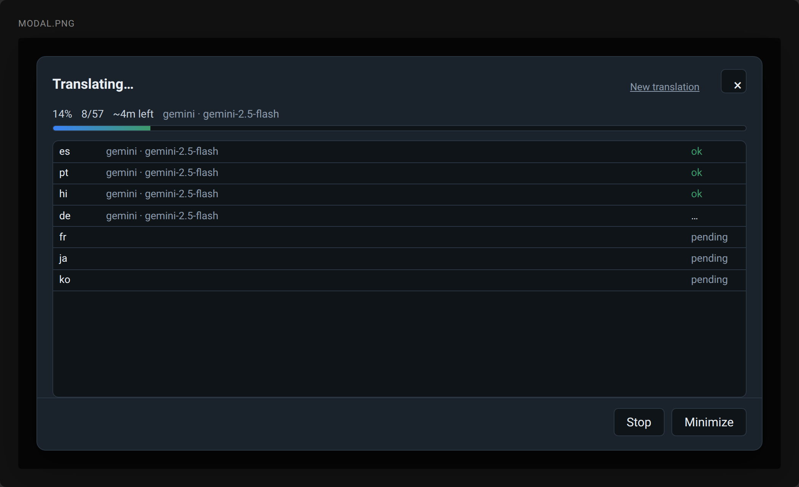
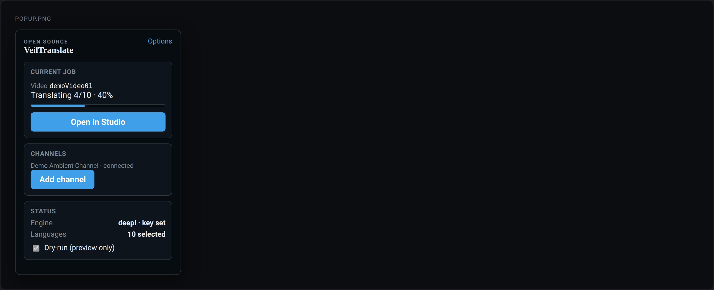
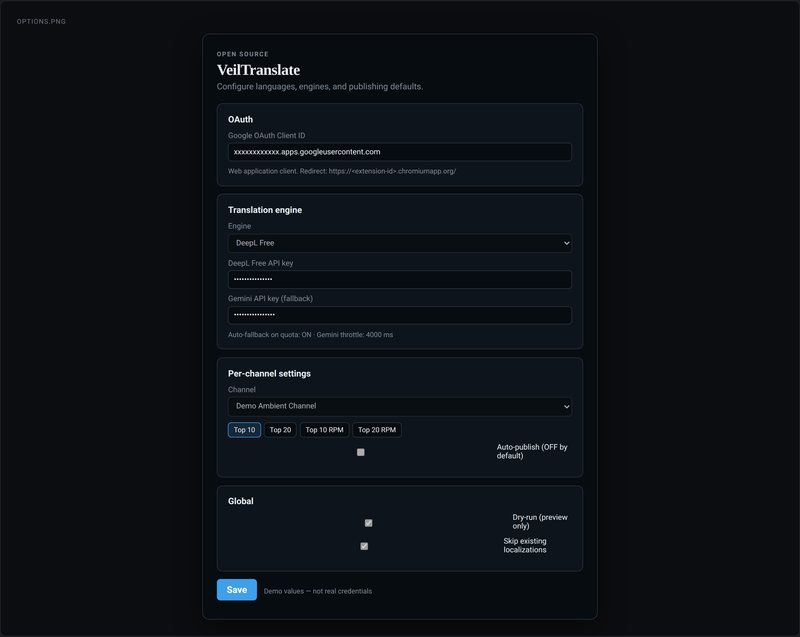

# VeilTranslate

Chrome extension (Manifest V3) that adds an **Auto Titles & Description** button on YouTube Studio video pages, translates title + description into selected languages, previews them, then publishes as YouTube **localizations** via the official Data API v3.

## Requirements

- Node.js 20+
- Google Chrome
- Google Cloud project with YouTube Data API v3 + OAuth (see [SETUP.md](./SETUP.md))
- Translation API key (Gemini free tier recommended)

## Install & build

```bash
cd veil-translate
npm install
npm run build
npm test
```

Load unpacked extension:

1. Open `chrome://extensions`
2. Enable **Developer mode**
3. **Load unpacked** → select `extension/dist`
4. Open the toolbar **popup** (or Options) and finish the setup checklist (OAuth client ID + Gemini key)

## How to translate a video in 5 clicks

1. Open a Studio video: `…/video/<id>/edit` or `…/video/<id>/translations`.
2. Click the Studio-style pill **Auto Titles & Description**.
3. Pick a preset (Top 10 is preselected on first install) or tweak the language grid — badges mark languages that already have a localization. Leave **Skip existing** on (or choose **Overwrite**).
4. Click **Translate N languages** → wait for per-language progress → edit the preview table.
5. Turn off **Dry-run** in the modal only when ready, then **Publish**. Failed languages get a **Retry** on the result screen.

Dry-run defaults **ON** on first install. Never publishes without an explicit **Publish** click. Localizations are always **merged** (other languages are never deleted).

Toolbar popup: connected channels (avatar/title, Add channel / Remove, active selector), engine/key status, dry-run toggle, selection count, Options link, and a setup checklist linking to [SETUP.md](./SETUP.md) (§3 OAuth, §4 Gemini).

**Multi-channel:** connect each Google account (or Brand Account) via **Add channel**. In Studio, VeilTranslate detects the video’s `snippet.channelId` and uses that channel’s stored token only — never writes with another channel’s token. If the owning channel is not connected, the modal asks you to connect it.

Keyboard: **Enter** confirms the primary action, **Esc** closes the modal.

### Screenshots

| UI | Preview |
|----|---------|
| Language picker modal |  |
| Editable preview |  |
| Toolbar popup |  |
| Options page |  |

Regenerate (dev only, no network):

```bash
npx playwright install chromium
npm run screenshots
```

## Optional CLI

After `npm run build`:

```bash
# Create gitignored secrets (never commit)
cp .cli-secrets.example.json .cli-secrets.json
# edit keys + OAuth desktop/web client

npm run yt-translate -- VIDEO_ID --langs es,de,pl --engine gemini --dry-run
```

OAuth uses a local loopback on `http://127.0.0.1:7890/callback`. Tokens are stored in `.cli-secrets.json`.

## Project layout

| Path | Purpose |
|------|---------|
| `extension/` | MV3 source (Vite → `extension/dist`) |
| `extension/dev/` | Mock harness + Playwright screenshot capture |
| `shared/` | Translation engines + text helpers (extension + CLI) |
| `cli/` | Optional `yt-translate` Node CLI |
| `languages.json` | Language list + presets (Top 10 / Top 20 / Top 10 RPM estimate) |
| `SETUP.md` | Google Cloud / API key walkthrough |
| `docs/screenshots/` | UI PNGs for this README |

## Scripts

| Command | Action |
|---------|--------|
| `npm run build` | Build extension + CLI |
| `npm test` | Vitest unit tests |
| `npm run screenshots` | Capture docs/screenshots/*.png from mock harness |
| `npm run dev` | Rebuild extension |

## License

Private / personal use for Veil of Veles channel tooling.
