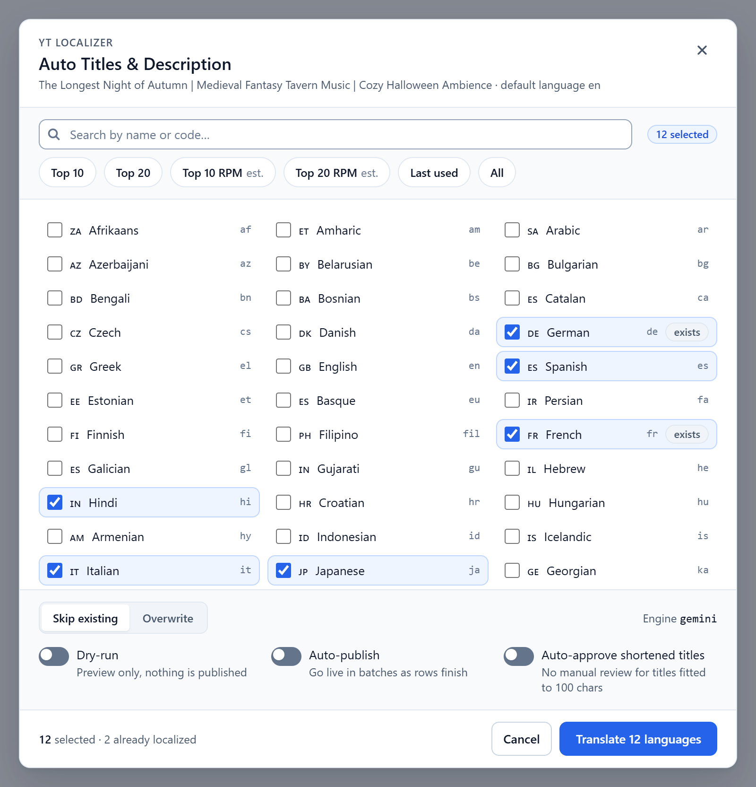
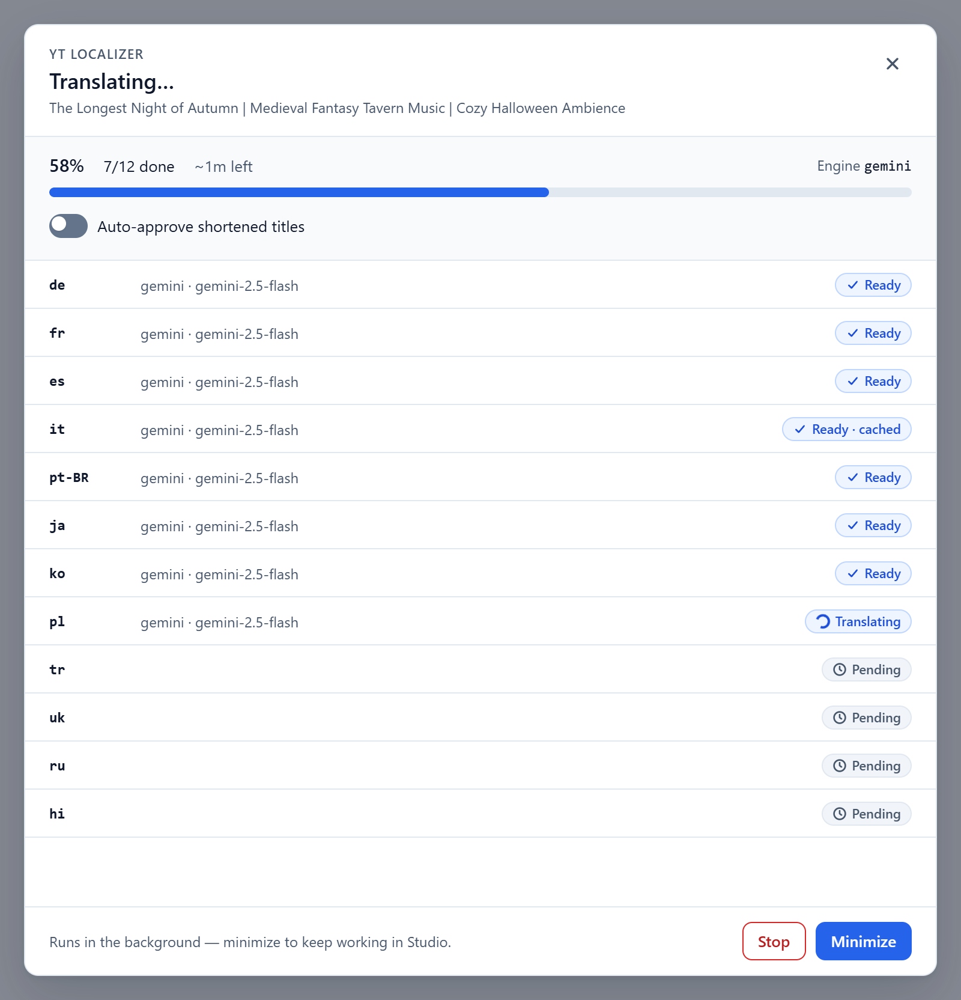
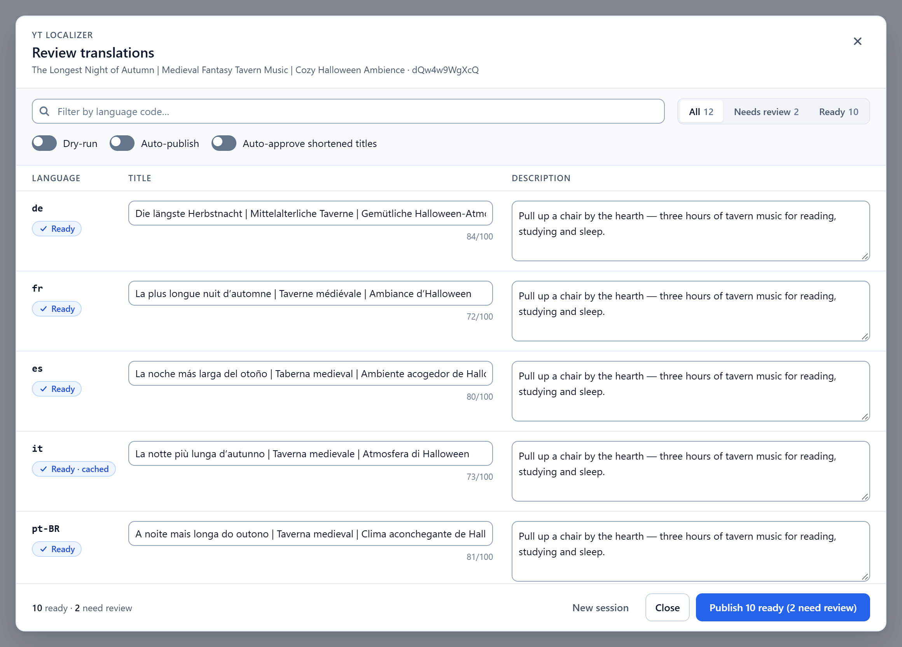
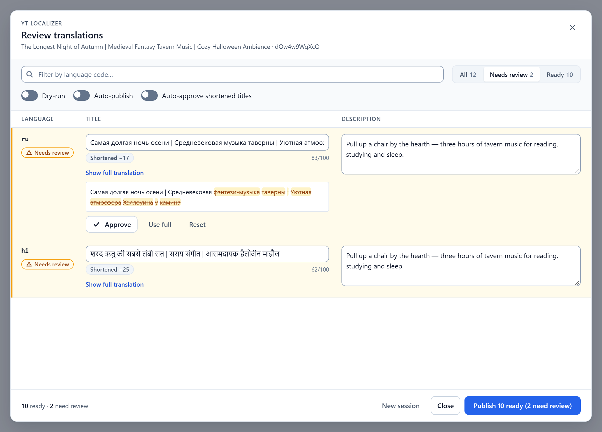
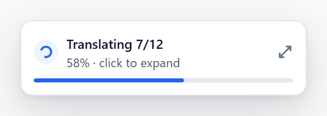
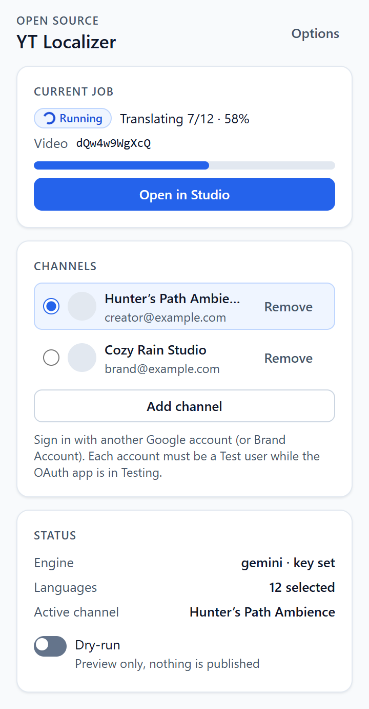
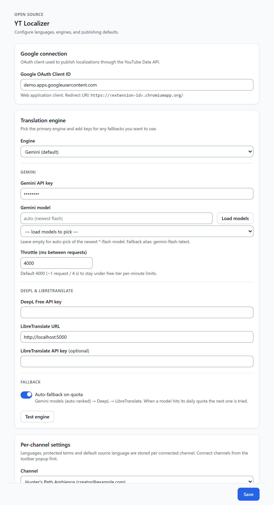
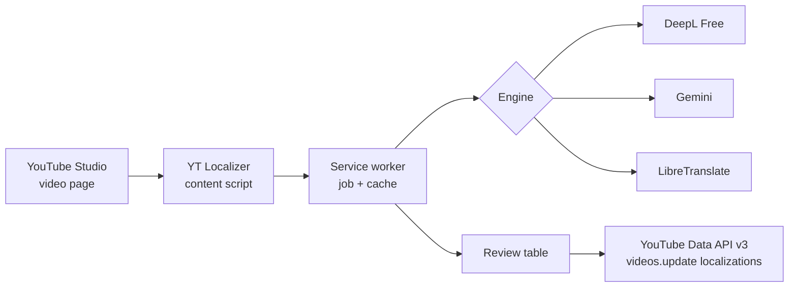

# YT Localizer

[](./LICENSE)
[](https://github.com/MykolaRudnev/yt-localizer/actions/workflows/ci.yml)
[](https://buymeacoffee.com/mykolarudnev)

**Translate YouTube titles & descriptions into official localizations — free, local, open source.**

Chrome MV3 extension (+ optional CLI) that adds an **Auto Titles & Description** control on YouTube Studio video pages, translates with DeepL / Gemini / LibreTranslate, lets you preview, then publishes via the official **YouTube Data API v3**.



## Features

- **One-click Studio flow** — pick **Top 10**, **Top 20**, **Top 10 RPM**, **Top 20 RPM**, or a custom language set
- **Engines** — DeepL Free (primary), Gemini free-tier fallback (model auto-pick + quota cascading), LibreTranslate (self-hosted)
- **Review before publish** — edit titles/descriptions inline; filter rows by *All / Needs review / Ready* or language code; one sticky **Publish N ready (M need review)** button; dry-run ON by default
- **Reviewable title shortening** — segment-aware fit to YouTube’s 100-char limit; shortened rows need one-click Approve (or edit) before publish
- **Optional auto-approve** — accept fitted titles automatically (Options or modal toggle, default off); rows get an *auto-approved* badge
- **Opt-in auto-publish** — or explicit Publish after preview (shortened titles never auto-publish)
- **Background jobs** — progress modal with per-language status badges, minimized Studio widget, toolbar popup status
- **Translation cache** — stored per video, so closing the modal mid-job does not throw work away and large caches stay fast; Options shows stats and **Clear**
- **Clean, accessible UI** — one blue design system for Studio modal, widget, popup and options; keyboard navigation and visible focus; light/dark follows Studio (modal) or your OS (popup/options)
- **Multi-channel / multi-account** — per-channel OAuth tokens and language settings
- **Optional CLI** — same pipeline from the terminal

| Language picker | Progress | Review |
|-----------------|----------|--------|
|  |  |  |

| Shortened titles | Widget | Popup | Options |
|------------------|--------|-------|---------|
|  |  |  |  |

## Why

Paid “bulk localization” tools charge monthly for what the YouTube API already supports. YT Localizer is a thin, auditable layer: your keys stay in `chrome.storage`, translations go through APIs you choose, and publishes use official `videos.update` localizations — no scraping Studio forms.

## Quick start

```bash
git clone https://github.com/MykolaRudnev/yt-localizer.git
cd yt-localizer
npm ci
npm test
npm run build
```

1. Follow **[SETUP.md](./SETUP.md)** (YouTube Data API v3 + OAuth Web client + DeepL/Gemini keys).
2. Chrome → `chrome://extensions` → Developer mode → **Load unpacked** → `extension/dist`.
3. Options: paste **OAuth Client ID** + at least one translation key.
4. Popup → **Add channel** (account must be an OAuth test user).
5. Open a Studio video → **Auto Titles & Description** → translate with dry-run → review → Publish.

More detail: [docs/CONFIGURATION.md](./docs/CONFIGURATION.md) · [docs/CLI.md](./docs/CLI.md)

## How it works



1. Content script injects the Studio control and shows the modal / widget.
2. Background worker runs the shared pipeline (engines in `shared/`).
3. OAuth tokens are scoped per connected channel; the video’s `channelId` selects which token may write.
4. Localizations are **merged** — other languages on the video are never deleted.

## Costs & quotas

| Resource | Typical limit / cost | Notes |
|----------|----------------------|--------|
| YouTube Data API | **10 000 units/day** (default project) | `videos.list` ≈ 1 unit; `videos.update` ≈ **50 units** |
| DeepL API Free | **500 000 characters / month** | Free keys end with `:fx` |
| Gemini (AI Studio) | Free-tier RPM / RPD vary by model | Auto model pick + throttle (default 4s) + quota fallback |
| LibreTranslate | Your hardware / host | No Google/DeepL quota |

A Top 10 batch is usually well within a default YouTube day quota; large “all languages” runs add up quickly because of `videos.update`.

## Privacy

- API keys and OAuth tokens live in **`chrome.storage.local`** (or gitignored `.cli-secrets.json` for the CLI).
- Nothing is sent to a YT Localizer server — there isn’t one.
- Network calls go to Google (OAuth + YouTube + optional Gemini), DeepL, and/or your LibreTranslate URL.
- See [SECURITY.md](./SECURITY.md).

## FAQ / troubleshooting

| Symptom | Fix |
|---------|-----|
| `invalid_client` | Wrong Client ID, or client type is not **Web application**. Recreate and paste the ID into Options. |
| `redirect_uri_mismatch` | Authorized redirect URI must be exactly `https://<extension-id>.chromiumapp.org/` (trailing slash). Forks: use your own ID after removing/regenerating the manifest `"key"` — see [SETUP.md](./SETUP.md). |
| `access_denied` / test users | OAuth app in **Testing**: add that Google account under **Test users**. |
| Quota exhausted (YouTube / Gemini / DeepL) | Wait for reset, reduce language count, or enable fallback engines. |
| Gemini JSON mode errors | Extension retries without JSON mode; leave model on auto or pick a current flash model. |
| DeepL unsupported language | Falls back to Gemini when a Gemini key is set; see job notes. |
| “Receiving end does not exist” | Refresh the Studio tab so the content script reinjects, then reopen the popup / modal. |
| Old UI still shows after updating | Reload the extension in `chrome://extensions`, then refresh the Studio tab (F5) — an open tab keeps the previous content script. |
| “Extension storage is full” | Options → **Clear translation cache**, then **Retry** the remaining languages. |
| Publish disabled | Dry-run is ON (default). Turn it off in Options, popup, or the modal when ready. |

## Roadmap

- Chrome Web Store packaging notes
- Richer per-language quality hints
- Optional glossary / term lists beyond protected terms

Contributions welcome — see [CONTRIBUTING.md](./CONTRIBUTING.md).

## Project layout

| Path | Purpose |
|------|---------|
| `extension/` | MV3 source (Vite → `extension/dist`) |
| `extension/src/background/` | Service worker modules (message handlers, job store, translate run, publish) |
| `extension/src/content/` | Studio UI (session controller, picker, progress / review / result views, widget) |
| `extension/src/ui/` | Design system: tokens, shared components, icons — documented in [design.md](./design.md) |
| `extension/dev/` | Screenshot harness: real views + fake `chrome` APIs with demo data |
| `shared/` | Engines, title fitting, pipeline, job state (extension + CLI) — see [docs/ARCHITECTURE.md](docs/ARCHITECTURE.md) |
| `cli/` | Optional `yt-localizer` CLI |
| `languages.json` | Language list + presets |
| `docs/` | Configuration, CLI, screenshots |
| `SETUP.md` | Google Cloud / API key walkthrough |

## Scripts

| Command | Action |
|---------|--------|
| `npm run build` | Build extension + CLI |
| `npm run typecheck` | `tsc --noEmit` for extension/shared and CLI |
| `npm test` | Vitest |
| `npm run screenshots` | Capture `docs/screenshots/*.png` from the real UI on demo data |
| `npm run yt-localizer` | Run the CLI |

```bash
# Screenshots (Playwright + system Chrome; fake data only)
npm run screenshots
```

## Support

If YT Localizer saved you time, you can [buy me a coffee](https://buymeacoffee.com/mykolarudnev).

## License

[MIT](./LICENSE) © 2026 Mykola Rudnev
